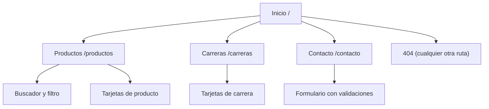

# PC3 – Avance N°1: Trujillo Runners Hub (React + Tailwind CSS)

**Curso:** Javascript Avanzado  
**Integrantes:** (completar con los nombres del grupo)

---

## Pregunta 1. Definición del proyecto y objetivos

**Nombre del proyecto:** Trujillo Runners Hub

**Descripción:**
Trujillo Runners Hub es una página web para los corredores de Trujillo y de la Región La Libertad. En ella se pueden ver las carreras de la temporada (5K, 10K y 12K), comprar productos para correr (zapatillas, relojes, accesorios y ropa) y contactarse con el equipo para inscribirse o hacer consultas.

**Público objetivo:**
- Personas que quieren empezar a correr (principiantes).
- Corredores regulares y avanzados que buscan carreras y equipo.
- Jóvenes y adultos de entre 15 y 50 años que usan celular o computadora.

**Necesidad que satisface:**
Hoy la información de las carreras y la venta de accesorios está dispersa en redes sociales. La página reúne todo en un solo lugar, es fácil de usar desde el celular y permite buscar productos rápidamente.

**Objetivo general:**
Desarrollar una página web responsive con React y Tailwind CSS que permita a los corredores de Trujillo informarse sobre las carreras, ver y buscar productos deportivos y contactarse con la organización.

**Objetivos específicos:**
1. Diseñar la línea gráfica y la estructura de la página (menú, sitemap y wireframes) para que la navegación sea clara.
2. Desarrollar componentes reutilizables en React y organizar las vistas con React Router.
3. Consumir una API simulada con JSON Server para mostrar productos y carreras de forma dinámica, con buscador, filtro y formulario validado.

---

## Pregunta 2. Requisitos funcionales y no funcionales

### Requisitos funcionales

| Código | Descripción | Prioridad |
|--------|-------------|-----------|
| RF-01 | El sistema debe mostrar un menú de navegación con acceso a Inicio, Productos, Carreras y Contacto. | Alta |
| RF-02 | El sistema debe mostrar el catálogo de productos (imagen, nombre, categoría, precio y stock) cargado desde una API. | Alta |
| RF-03 | El sistema debe permitir buscar productos por nombre. | Alta |
| RF-04 | El sistema debe permitir filtrar los productos por categoría. | Media |
| RF-05 | El sistema debe mostrar las carreras disponibles con su distancia, fecha, lugar y precio. | Alta |
| RF-06 | El sistema debe permitir agregar productos al carrito y mostrar la cantidad en el menú. | Media |
| RF-07 | El sistema debe tener un formulario de contacto que valide nombre, correo, asunto y mensaje antes de enviarlo. | Alta |
| RF-08 | El sistema debe mostrar una página 404 cuando la ruta no exista. | Media |

### Requisitos no funcionales

| Código | Descripción | Prioridad |
|--------|-------------|-----------|
| RNF-01 | **Usabilidad:** la página debe ser fácil de entender y usar, con un menú consistente en todas las vistas. | Alta |
| RNF-02 | **Responsive:** la página debe verse bien en celulares, tablets y computadoras (Tailwind CSS). | Alta |
| RNF-03 | **Rendimiento:** la página debe cargar en menos de 3 segundos con una conexión normal. | Media |
| RNF-04 | **Mantenibilidad:** el código debe estar organizado en componentes reutilizables y carpetas. | Alta |
| RNF-05 | **Compatibilidad:** la página debe funcionar en los navegadores Chrome, Edge y Firefox actuales. | Media |

---

## Pregunta 3. Arquitectura de información y menú de navegación

### Menú de navegación principal

| Opción | Ruta | Contenido |
|--------|------|-----------|
| Inicio | `/` | Hero, carreras, productos destacados y llamado a la acción |
| Productos | `/productos` | Catálogo completo con buscador y filtro por categoría |
| Carreras | `/carreras` | Lista de carreras 5K, 10K y 12K |
| Contacto | `/contacto` | Datos de contacto y formulario |
| (carrito) | — | Contador de productos agregados, visible en el menú |

### Estructura jerárquica

```
Trujillo Runners Hub
├── Inicio
│   ├── Hero
│   ├── Nuestras carreras
│   ├── Productos destacados
│   └── Llamado a la acción
├── Productos
│   ├── Buscador
│   ├── Filtro por categoría
│   └── Lista de productos
├── Carreras
│   └── Lista de carreras (5K, 10K, 12K)
├── Contacto
│   ├── Datos de contacto
│   └── Formulario
└── 404 (página no encontrada)
```

### Sitemap



---

## Pregunta 4. Línea gráfica e identidad visual

### Paleta de colores

| Uso | Nombre | Código |
|-----|--------|--------|
| Color principal | Naranja | `#FF6B35` |
| Principal (hover) | Naranja oscuro | `#E55A28` |
| Fondo oscuro (header y footer) | Negro azulado | `#111827` |
| Fondo de la página | Gris muy claro | `#F9FAFB` |
| Texto | Gris oscuro | `#1F2937` |
| Carrera 5K | Verde | `#10B981` |
| Carrera 12K | Morado | `#8B5CF6` |
| Error | Rojo | `#DC2626` |
| Éxito | Verde | `#16A34A` |

### Tipografías

| Uso | Fuente | Tamaño |
|-----|--------|--------|
| Títulos | Segoe UI Bold | 32 px (móvil) / 48 px (escritorio) |
| Subtítulos | Segoe UI Bold | 24 px |
| Texto normal | Segoe UI Regular | 16 px |
| Texto pequeño | Segoe UI Regular | 14 px |

### Estilo de botones

| Tipo | Estilo |
|------|--------|
| Principal | Fondo naranja `#FF6B35`, texto blanco, negrita, bordes redondeados (4 px), hover `#E55A28` |
| Secundario | Fondo blanco, texto naranja, mismo borde |
| Deshabilitado | Fondo gris `#9CA3AF`, cursor no permitido |

### Iconografía
Se usan emojis como íconos para mantener la página simple y liviana: 🏃 carreras, 🛒 carrito, 📅 fecha, 📍 lugar, 📞 teléfono, ✉️ correo.

### Imágenes
- Hero: foto de corredores en Trujillo (`hero.jpg` de la PC1), con una capa oscura encima para que se lea el texto.
- Logo: círculo con el logo del proyecto (`logo.jpg`).
- Productos: fotos de Unsplash con tamaño fijo (altura 192 px, `object-fit: cover`).

### Componentes visuales
- **Tarjeta de producto:** imagen, categoría, nombre, descripción, precio, stock y botón.
- **Tarjeta de carrera:** franja de color con la distancia, nombre, fecha, lugar y precio.
- **Header:** fondo negro fijo arriba, logo a la izquierda y menú a la derecha.
- **Footer:** fondo negro con tres columnas (marca, enlaces y redes).

### Guía para armar el moodboard en Figma (web y mobile)
1. Crear un archivo "Trujillo Runners Hub – Guía de estilos" con dos frames: **Web (1440 × 1024)** y **Mobile (390 × 844)**.
2. Dibujar rectángulos con cada color de la paleta y su código.
3. Agregar los textos de ejemplo con las tipografías de la tabla.
4. Agregar un botón principal, uno secundario y uno deshabilitado.
5. Pegar la foto del hero, el logo y dos fotos de productos.
6. Dibujar una tarjeta de producto y una de carrera.

---

## Pregunta 5. Estructura del Home e implementación inicial

### Estructura de secciones del Home

1. **Header:** logo, menú (Inicio, Productos, Carreras, Contacto) y contador del carrito.
2. **Hero:** imagen de fondo, título "CORRE TRUJILLO. SUPERA TUS LÍMITES.", subtítulo y botón "Ver productos".
3. **Contenido principal:**
   - Nuestras carreras (3 tarjetas).
   - Productos destacados (4 tarjetas).
4. **CTA:** bloque naranja "¿Listo para tu próxima carrera?" con botón "Quiero inscribirme".
5. **Footer:** marca, enlaces y redes sociales.

### Wireframe del Home – Web (1440 px)

```
+--------------------------------------------------------------+
| [logo] Trujillo Runners Hub     Inicio Productos Carreras Contacto 🛒0 |  <- Header
+--------------------------------------------------------------+
|                                                              |
|   CORRE TRUJILLO.                                            |
|   SUPERA TUS LÍMITES.                      (imagen de fondo) |  <- Hero
|   subtitulo...                                               |
|   [ Ver productos ]                                          |
|                                                              |
+--------------------------------------------------------------+
|  | Nuestras carreras                                         |
|  [ 5K card ]      [ 10K card ]      [ 12K card ]             |  <- Contenido
|                                                              |
|  | Productos destacados                                      |
|  [prod][prod][prod][prod]                                    |
+--------------------------------------------------------------+
|  ¿Listo para tu próxima carrera?  [ Quiero inscribirme ]     |  <- CTA
+--------------------------------------------------------------+
|  Marca            Enlaces            Síguenos                |  <- Footer
|  © 2026 Trujillo Runners Hub                                 |
+--------------------------------------------------------------+
```

### Wireframe del Home – Mobile (390 px)

```
+--------------------+
| [logo] Runners  ☰  |  <- Header (menú hamburguesa)
+--------------------+
| CORRE TRUJILLO.    |
| SUPERA TUS LÍMITES.|  <- Hero
| [ Ver productos ]  |
+--------------------+
| | Nuestras carreras|
| [ 5K card ]        |
| [ 10K card ]       |
| [ 12K card ]       |
+--------------------+
| | Destacados       |
| [producto]         |
| [producto]         |
+--------------------+
| ¿Listo para correr?|
| [ Inscribirme ]    |  <- CTA
+--------------------+
| Marca / Enlaces    |  <- Footer
+--------------------+
```

> Para el entregable en Figma: dibujar estos dos frames con rectángulos grises y textos, usando las medidas indicadas.

### Proyecto inicial
- **Tecnologías:** React 19, Vite, Tailwind CSS 4 y React Router.
- **Carpeta:** `runners-react/`
- **Menú:** funcional y responsive (hamburguesa en celular).
- **Componentes de esta pregunta:** `Header`, `Navbar`, `Hero` y `Footer`.

---

## Pregunta 6. Componentes reutilizables

Se crearon **9 componentes** organizados en `src/components/`:

| Componente | Props | Dónde se usa |
|------------|-------|--------------|
| `Header` | `cantidadCarrito` | En todas las páginas (App) |
| `Navbar` | `cantidadCarrito` | Dentro de `Header` |
| `Hero` | `titulo`, `subtitulo`, `textoBoton`, `enlace`, `imagen` | Home, Productos, Carreras y Contacto |
| `Footer` | — | En todas las páginas (App) |
| `ProductoCard` | `producto`, `onAgregar` | Home y Productos |
| `CarreraCard` | `carrera` | Home y Carreras |
| `Buscador` | `texto`, `categoria`, `categorias`, `onCambiarTexto`, `onCambiarCategoria` | Productos |
| `EstadoCarga` | `cargando`, `error` | Home, Productos y Carreras |
| `FormularioContacto` | — | Contacto |

**Componentes reutilizados en diferentes secciones:** `Hero` (4 páginas), `ProductoCard` (Home y Productos), `CarreraCard` (Home y Carreras) y `EstadoCarga` (3 páginas).

---

## Pregunta 7. React Router

- Instalado con `npm install react-router-dom`.
- `BrowserRouter` en `main.jsx` y las rutas en `App.jsx`.

| Ruta | Página |
|------|--------|
| `/` | Home |
| `/productos` | Productos |
| `/carreras` | Carreras |
| `/contacto` | Contacto |
| `*` | NotFound (404) |

- El menú usa `NavLink` (resalta la página actual) y el logo y los botones usan `Link`.
- El `Header` y el `Footer` están fuera de `Routes`, así que el menú es igual en todas las páginas.

---

## Pregunta 8. Creación y consumo de una API

- **API:** JSON Server con el archivo `db.json` (12 productos y 3 carreras).
- **Cómo levantarla:** `npm run api` (puerto 3000).
- **Consumo:** con `fetch` en `src/services/api.js`.
- **Hooks:** `useState` y `useEffect` en las páginas Home, Productos y Carreras.
- **Estados de carga y error:** componente `EstadoCarga` ("Cargando..." y mensaje de error).
- **Registros mostrados:** 12 productos (más de los 10 pedidos).
- **En internet:** como no hay JSON Server, la página lee el archivo público `/db.json`.

---

## Pregunta 9. Interactividad y gestión del estado

| Interacción | Evento | Hook |
|-------------|--------|------|
| Abrir y cerrar el menú en celular | `onClick` | `useState` |
| Buscar productos por nombre | `onChange` | `useState` |
| Filtrar por categoría | `onChange` | `useState` |
| Agregar al carrito y ver el contador | `onClick` | `useState` |
| Formulario de contacto con validaciones | `onSubmit` y `onChange` | `useState` |

**Validaciones del formulario:** nombre de mínimo 3 letras, correo con `@` y `.`, asunto seleccionado y mensaje de mínimo 10 caracteres. Los errores se muestran debajo de cada campo.

---

## Pregunta 10. Integración, diseño responsive y despliegue

- Todas las vistas y componentes están integrados en `App.jsx`.
- **Tailwind CSS:** se usan los prefijos `sm:`, `md:` y `lg:` para adaptar el diseño.

| Dispositivo | Ancho | Cambios |
|-------------|-------|---------|
| Móvil | 375 px | 1 columna y menú hamburguesa |
| Tablet | 768 px | 2 columnas y menú completo |
| Escritorio | 1280 px | 3 o 4 columnas |

- **Despliegue:** pendiente (Vercel). Link: (pegar aquí).
